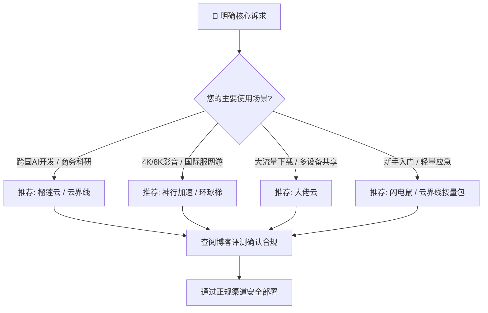

# 🌐 2026 魔法网络知识库：高速节点选型、专线评测与客户端配置指南

> **收录 2026 最新网络协议技术科普、IEPL/IPLC 内网专线横评、全平台客户端（Clash / Clash Verge Rev / Sing-box / Shadowrocket）配置教程与流媒体高码率解锁实战。**

[📖 访问官方博客](https://mofaclashjichang.com) • [📊 节点评测汇总](https://mofaclashjichang.com/reviews.html) • [📚 归档知识库](https://mofaclashjichang.com/archive.html) • [⚖️ 免责声明](#-合规与免责声明-compliance--disclaimer)

---

## 📌 目录导航 (Table of Contents)

- [🎯 知识库定位与核心价值](#-知识库定位与核心价值)
- [🏆 2026 年度精选网络服务品牌推荐矩阵](#-2026-年度精选网络服务品牌推荐矩阵)
  - [1. 云界线 (Yunjiexian) - 旗舰级全专线与不限时按量选型](#1-云界线-yunjiexian---旗舰级全专线与不限时按量选型)
  - [2. 大佬云 (Dalaoyun) - 极致性价比与高并发多设备支持](#2-大佬云-dalaoyun---极致性价比与高并发多设备支持)
  - [3. 环球梯 (Huanqiuti) - 全球多区域冗余与 4K 流媒体专线](#3-环球梯-huanqiuti---全球多区域冗余与-4k-流媒体专线)
  - [4. 榴莲云 (Liulianyun) - 跨境 AI 加速与稳定办公首选](#4-榴莲云-liulianyun---跨境-ai-加速与稳定办公首选)
  - [5. 神行加速 (Shenxing) - 超低延迟极速网络与低抖动专线](#5-神行加速-shenxing---超低延迟极速网络与低抖动专线)
  - [6. 闪电鼠 (Shandianshu) - 轻量入门与高性价比日常伴侣](#6-闪电鼠-shandianshu---轻量入门与高性价比日常伴侣)
- [📚 博客精选技术专栏与实战指南](#-博客精选技术专栏与实战指南)
  - [🔰 新手极速上手与全平台客户端指南](#-新手极速上手与全平台客户端指南)
  - [🔬 硬核网络协议与专线技术深度科普](#-硬核网络协议与专线技术深度科普)
  - [🤖 跨境 AI 办公与流媒体高码率解锁](#-跨境-ai-办公与流媒体高码率解锁)
  - [🛡️ 避坑防雷指南与高可用冗余策略](#️-避坑防雷指南与高可用冗余策略)
- [🧭 30秒选型决策树 (Decision Matrix)](#-30秒选型决策树-decision-matrix)
- [⚖️ 合规与免责声明 (Compliance & Disclaimer)](#-合规与免责声明-compliance--disclaimer)

---

## 🎯 知识库定位与核心价值

本仓库为 **[魔法 Clash 机场知识库 (mofaclashjichang.com)](https://mofaclashjichang.com)** 的官方同步开源导航。旨在为全球华人开发者、科研学者、跨境电商从业者及网络技术爱好者提供客观、中立、数据驱动的：

1. **底层线路测评**：深入剖析 IEPL 内网专线、IPLC 国际专线、BGP 跨境中继与直连线路的真实表现；
2. **协议与工具指南**：涵盖 Clash Verge Rev、Mihomo (Clash.Meta)、Sing-box、Shadowrocket 等主流内核与客户端的精细化规则分流策略；
3. **真实测速基准**：晚高峰 32 线程压测数据公开，绝不弄虚作假，拒绝溢美之词；
4. **安全与隐私保护**：DNS 泄漏排查、WebRTC 隐私加固、节点跑路预警机制与容灾备份方案。

---

## 🏆 2026 年度精选网络服务品牌推荐矩阵

以下为博客实测团队历经 2026 年度多轮晚高峰严格压力测试、流媒体解锁监测及 SLA 可用性统计后，挑选出的 6 款综合表现最优的服务品牌：

| 排名 | 品牌名称 | 线路架构类型 | 核心优势与特色 | 博客深度实测报告 | 官方直达通道 |
| :---: | :---: | :---: | :---: | :---: | :---: |
| 🥇 **TOP 01** | **云界线** | 企业级 IEPL 专线 | 亚洲节点低延迟、不限设备、提供按量不限时包 | [📖 深度测评报告](https://mofaclashjichang.com/airports/yunjiexian/) | [🔗 访问官网 ↗](https://9625mofan01.yunjiexianaff.com/#/?code=OOYhSj0L) |
| 🥈 **TOP 02** | **大佬云** | BGP 入口 + IPLC 专线 | 海量流量包、高并发连接、性价比突出 | [📖 深度测评报告](https://mofaclashjichang.com/airports/dalaoyun/) | [🔗 访问官网 ↗](https://mofanvip01.dalaoyunaff.com/#/?code=QT2rqp5V) |
| 🥉 **TOP 03** | **环球梯** | 全球多路由中继专线 | 冷门冷区覆盖广、奈飞/迪士尼全解锁、高容灾 | [📖 深度测评报告](https://mofaclashjichang.com/airports/huanqiuti/) | [🔗 访问官网 ↗](https://mofanvip01.huanqiutiaff.com/#/?code=l7oLmjVU) |
| 🎖️ **TOP 04** | **榴莲云** | 高速专线 + 优化直连 | ChatGPT/Claude 纯净解锁、套餐梯队灵活 | [📖 深度测评报告](https://mofaclashjichang.com/airports/liulianyun/) | [🔗 访问官网 ↗](https://mofan88.liulianyunaff.com/#/?code=ETsQBSuR) |
| 🎖️ **TOP 05** | **神行加速** | 极速专线接入群 | 超低抖动率与丢包率、4K/8K 视频秒开、游戏加速 | [📖 深度测评报告](https://mofaclashjichang.com/airports/shenxing/) | [🔗 访问官网 ↗](https://vipmofan01.shenxingaff.com/#/?code=nn4ohwnK) |
| 🎖️ **TOP 06** | **闪电鼠** | 轻量专线与优质公网 | 门槛超低、轻量用户福音、稳定日常冲浪首选 | [📖 深度测评报告](https://mofaclashjichang.com/airports/shandianshu/) | [🔗 访问官网 ↗](https://mofanvip01.shandianshuaff.com/#/?code=a3GAQAXg) |

> 💡 **特别提醒**：根据网络可用性工程学原则，**切勿将鸡蛋放在一个篮子里**。建议至少配置一主一副（不同接入服务商）的双节点冗余方案，详细策略请阅读 [《2026 机场跑路预警与高可用备份策略》](https://mofaclashjichang.com/posts/2026-airport-exit-scam-warning-backup-strategy/)。

---

### 1. 云界线 (Yunjiexian) - 旗舰级全专线与不限时按量选型

- **定位**：全能主力型 / 商务与跨境科研首选
- **技术亮点**：采用全专线接入隧道，支持 Vless 协议。根据晚高峰实测，香港、台湾、新加坡节点平均下载速率高达 20–25MB/s（约 160–200Mbps），TLS RTT 延迟极低（22–46ms），几乎无丢包。
- **灵活资费**：除了按月度计费的标准订阅外，还极具特色地提供了 **80GB / 200GB 一次性不限时流量包**，适合低频或作为长期备用通道的用户。
- **推荐场景**：4K 高清视频、远程会议、跨境办公、多设备家庭共享。
- 🔗 **评测详情**：[云界线 2026 套餐价格与实测分析](https://mofaclashjichang.com/airports/yunjiexian/)
- 🚀 **官方站点**：[点击直达云界线官方平台 ↗](https://9625mofan01.yunjiexianaff.com/#/?code=OOYhSj0L)

---

### 2. 大佬云 (Dalaoyun) - 极致性价比与高并发多设备支持

- **定位**：大流量吞吐 / 性价比多终端之王
- **技术亮点**：BGP 优质多线接入配合内网通道，针对高峰期网络拥塞做了智能化负载均衡。单账号允许连接设备上限高，并发吞吐量坚挺。
- **推荐场景**：PT 下载、大文件同步、团队开发环境网络调优、多移动设备常驻后台。
- 🔗 **评测详情**：[大佬云 2026 线路质量与套餐解析](https://mofaclashjichang.com/airports/dalaoyun/)
- 🚀 **官方站点**：[点击直达大佬云官方平台 ↗](https://mofanvip01.dalaoyunaff.com/#/?code=QT2rqp5V)

---

### 3. 环球梯 (Huanqiuti) - 全球多区域冗余与 4K 流媒体专线

- **定位**：流媒体重度爱好者 / 跨国冷区解锁专家
- **技术亮点**：节点覆盖遍及港台日韩新美英等主流区域，并配置南美、欧洲多国冷门边缘节点。针对 Netflix、Disney+、HBO Max 及 YouTube 进行了专用原生 IP 伪装与 DNS 劫持防护。
- **推荐场景**：跨区流媒体追剧、海外游戏锁区登录、国际学术资源访问。
- 🔗 **评测详情**：[环球梯 2026 全球节点与流媒体解锁实测](https://mofaclashjichang.com/airports/huanqiuti/)
- 🚀 **官方站点**：[点击直达环球梯官方平台 ↗](https://mofanvip01.huanqiutiaff.com/#/?code=l7oLmjVU)

---

### 4. 榴莲云 (Liulianyun) - 跨境 AI 加速与稳定办公首选

- **定位**：海外 AI 大模型开发 / 跨境电商生产力工具
- **技术亮点**：精细化落地 IP 库维护，有效规避 OpenAI、Claude、Midjourney 等风控级别严苛的平台验证码拦截；连接稳定性高，掉线率极低。
- **推荐场景**：ChatGPT / Claude 提示工程调试、海外社交媒体营销、外贸沟通。
- 🔗 **评测详情**：[榴莲云 2026 AI 解锁能力与价格评测](https://mofaclashjichang.com/article-liulianyun-2026-review.html)
- 🚀 **官方站点**：[点击直达榴莲云官方平台 ↗](https://mofan88.liulianyunaff.com/#/?code=ETsQBSuR)

---

### 5. 神行加速 (Shenxing) - 超低延迟极速网络与低抖动专线

- **定位**：竞技级网络连接 / 苛刻低延迟场景
- **技术亮点**：优化骨干专线路由，物理链路直达，网络抖动（Jitter）与丢包率近乎为零，高峰期线路表现极其平稳。
- **推荐场景**：国际服竞技网游加速、4K/8K 极限高码率无缓冲拖拽播放、金融级行情接收。
- 🔗 **评测详情**：[神行加速 2026 极速节点深度压测](https://mofaclashjichang.com/article-shenxing-2026-review.html)
- 🚀 **官方站点**：[点击直达神行加速官方平台 ↗](https://vipmofan01.shenxingaff.com/#/?code=nn4ohwnK)

---

### 6. 闪电鼠 (Shandianshu) - 轻量入门与高性价比日常伴侣

- **定位**：轻量级用户 / 备用应急节点
- **技术亮点**：极简配置流程，对初学者十分友好。资费设置门槛极低，日常网页查阅、文档搜索与社交交流体验丝滑。
- **推荐场景**：刚接触网络代理工具的新手小白、每月用量有限的轻度使用者。
- 🔗 **评测详情**：[闪电鼠 2026 入门体验与性价比实测](https://mofaclashjichang.com/article-shandianshu-2026-review.html)
- 🚀 **官方站点**：[点击直达闪电鼠官方平台 ↗](https://mofanvip01.shandianshuaff.com/#/?code=a3GAQAXg)

---

## 📚 博客精选技术专栏与实战指南

博客官方收录了数十篇涵盖网络架构、客户端调优与安全风控的深度技术解析，以下为您精选最受开发者欢迎的必读文章：

### 🔰 新手极速上手与全平台客户端指南
- [📖 2026 新手 Clash 机场选择与入门配置闭环指南](https://mofaclashjichang.com/posts/2026-clash-beginner-airport-selection-guide/)：从节点订阅、配置导入到规则策略组切换的零基础教程。
- [📖 2026 最新 Clash Verge Rev 完整安装与高级分流实战](https://mofaclashjichang.com/posts/2026-clash-verge-rev-guide/)：现代 Clash 客户端首选工具的 Script 脚本分流与 TUN 虚拟网卡配置。
- [📖 2026 全平台网络代理客户端选型全景横评](https://mofaclashjichang.com/posts/2026-proxy-client-selection-guide/)：对比 Windows / macOS / iOS / Android / Linux 下的最佳内核与客户端方案。
- [📖 软路由网关透明代理 vs 终端设备独立代理全面对比](https://mofaclashjichang.com/posts/2026-router-proxy-vs-device-client-guide/)：如何为全屋智能家居与移动工作站设计最合理的分流架构。

### 🔬 硬核网络协议与专线技术深度科普
- [📖 IEPL / IPLC 内网专线 vs BGP / CN2 中继线路深度全景科普](https://mofaclashjichang.com/posts/2026-iepl-iplc-bgp-cn2-line-guide/)：透视跨境物理光缆架构，为什么专线能无视晚高峰阻断。
- [📖 网络延迟 (Latency)、丢包率 (Packet Loss) 与抖动 (Jitter) 对实际体验的影响](https://mofaclashjichang.com/posts/2026-latency-packet-loss-jitter-guide/)：手把手教你读懂测速面板，告别唯“测速带宽论”。
- [📖 DNS 泄漏、WebRTC 与 IPv6 泄漏全流程排查与防范方案](https://mofaclashjichang.com/posts/2026-dns-webrtc-ipv6-leak-guide/)：保障真实物理 IP 安全，构建无漏洞的系统级加密环境。
- [📖 晚高峰节点真实网络测速与性能压力测试方法论](https://mofaclashjichang.com/posts/2026-airport-evening-peak-speed-test-guide/)：32 线程持续并发测速与链路追踪（Traceroute）实战。

### 🤖 跨境 AI 办公与流媒体高码率解锁
- [📖 ChatGPT / Claude 原生住宅 IP 节点防封禁风控指南](https://mofaclashjichang.com/posts/2026-chatgpt-claude-1020-native-residential-ip-guide/)：深度解析 1020 报错根源、风控算法机制与住宅 IP 路由选择。
- [📖 Netflix / Disney+ / YouTube 4K 流媒体解锁与节点筛选技巧](https://mofaclashjichang.com/posts/2026-netflix-disney-youtube-4k-airport-guide/)：告别非自制剧限制，畅享 Dolby Vision 与高码率体验。

### 🛡️ 避坑防雷指南与高可用冗余策略
- [📖 2026 机场跑路预警信号与高可用双备冗余策略](https://mofaclashjichang.com/posts/2026-airport-exit-scam-warning-backup-strategy/)：如何识别跑路前兆、规避长期年付风险，搭建自动化故障转移策略。
- [📖 为什么强烈不建议使用“免费机场”与“一元机场”？](https://mofaclashjichang.com/posts/2026-why-free-airports-are-unreliable/)：从中间人攻击、日志明文记录与黑灰产风险揭示廉价节点的代价。
- [📖 不限时按量付费（一次性流量包）选购与适用场景对比](https://mofaclashjichang.com/posts/2026-pay-as-you-go-no-expiry-airport-guide/)：告别每月流量清零焦虑，低频用户的省钱秘籍。
- [📖 订阅更新失败与无法连接常见故障 10 步排错清单](https://mofaclashjichang.com/posts/2026-subscription-update-failed-troubleshooting/)：解决节点报错、证书过期、系统时间误差导致的中断。

---

## 🧭 30秒选型决策树 (Decision Matrix)

根据您的核心需求，快速定位最匹配的服务方案：

---

## ⚖️ 合规与免责声明 (Compliance & Disclaimer)

1. **学术研究与技术科普宗旨**：
   本仓库及关联博客所发布之所有文章、架构设计、测速数据及客户端使用说明，**仅用于计算机网络拓扑学习、通信协议性能基准测试、跨国科研数据检索及开源软件部署的技术交流**。
2. **遵守法律法规倡议**：
   使用者应当严格遵守所在国家与地区的法律、法规及行政规章制度。**严禁利用本仓库及所提网络技术从事任何破坏网络安全、侵犯他人隐私或违反法律法规的非法活动**。
3. **商业透明度披露 (Affiliate Disclosure)**：
   本知识库始终坚守独立、客观的评测立场。为了支持服务器带宽、测速节点采购与开源维护的长期运营，本页面部分外部跳转链接可能包含推广返利代码（Affiliate Codes）。该举措不会对消费者的购买价格产生任何额外成本，感谢您的理解与支持。
4. **版权与许可**：
   本项目文档基于 [CC BY-NC-SA 4.0 (知识共享署名-非商业性使用-相同方式共享 4.0 国际许可协议)](https://creativecommons.org/licenses/by-nc-sa/4.0/deed.zh) 开源分发。

---

**🌟 如果本知识库对您的网络研究与配置有所帮助，欢迎点亮右上角的 Star ⭐️ 予以支持！**

*Copyright © 2026 [魔法 Clash 机场知识库](https://mofaclashjichang.com) • All Rights Reserved.*

